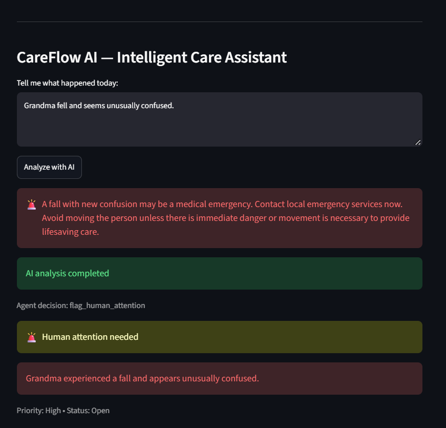
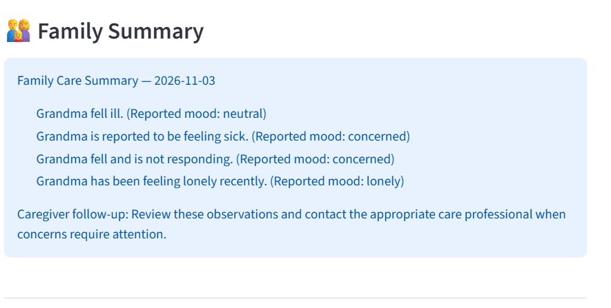
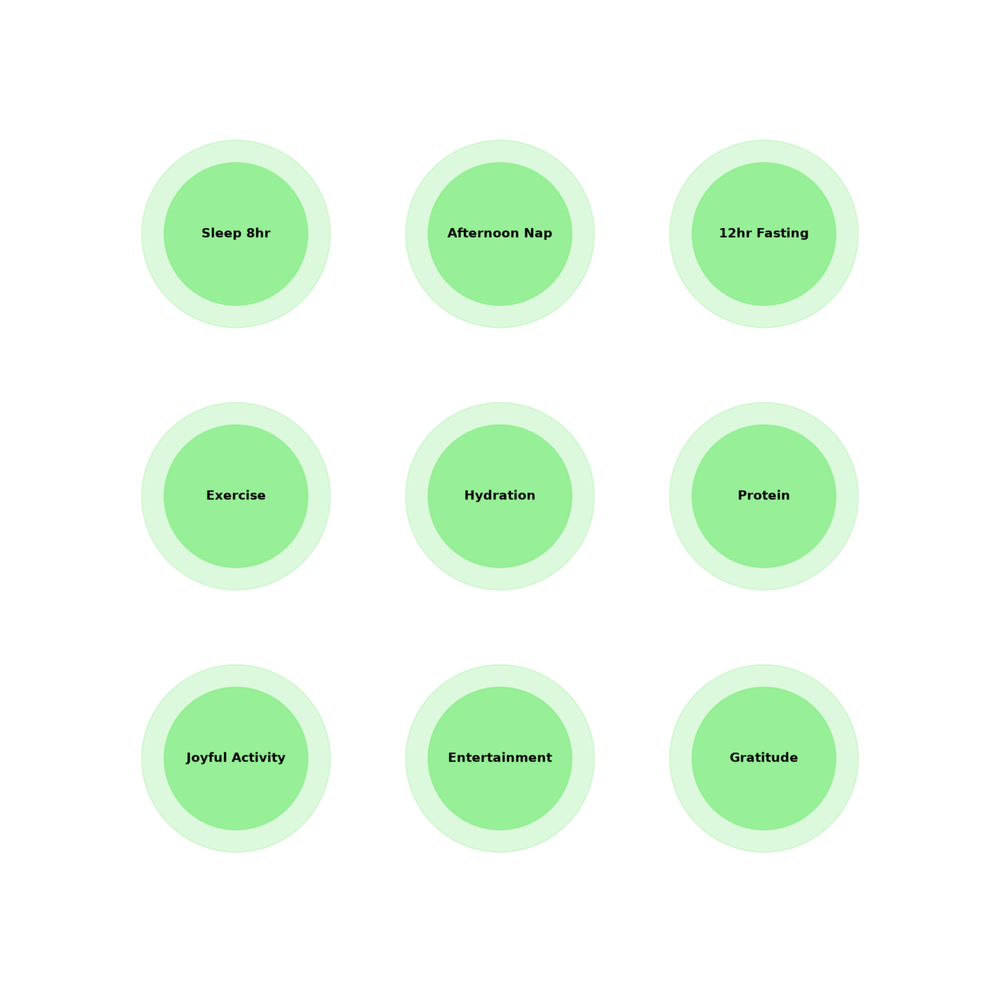

# CareFlow AI — Elder Care Companion

**An AI-powered elder-care coordination assistant designed to help families stay informed, organized, and connected.**

CareFlow AI builds on the original Elderly Mood Companion project, evolving it into an everyday elder-care coordination application.

It helps caregivers organize observations, maintain care-related memories, coordinate tasks, identify situations requiring human attention, and communicate important updates with family members.

---

## Key Features

- **Caregiver Observation Analysis:** Processes caregiver messages and generates structured observations and follow-up suggestions.
- **Mood Identification:** Identifies conversational mood signals to support everyday interactions.
- **Caregiver Memory:** Saves and retrieves previous care observations.
- **Task Coordination:** Creates caregiver tasks based on identified needs.
- **Human Attention Alerts:** Flags potentially urgent messages for human intervention.
- **Family Summary:** Organizes recent observations, filters duplicate entries, and generates concise family updates.
- **Everyday Wellness Check-ins:** Supports routine check-ins and provides visual feedback through wellness progress rings.

---

## Meta Global AI Developer Hackathon Contributions

The following improvements were developed during the Meta Global AI Developer Hackathon.

### 1. Human Attention Alerts

Introduced a human-attention escalation workflow that identifies potentially urgent caregiver messages and creates high-priority alerts for human review.

**Example:** A simulated message indicating that an older adult has fallen and is unresponsive can trigger a high-priority alert.

This feature helps ensure that potentially critical situations receive human attention rather than being treated as ordinary conversations.

### 2. Improved Family Summary

Improved family summaries to make recent care information easier to understand and review.

Key improvements include:

- Latest-observation filtering.
- Duplicate-entry filtering.
- Concise summaries of recent care observations.
- Caregiver follow-up suggestions.

These improvements aim to make family communication clearer and help caregivers identify information requiring attention.

---

## High-Level System Architecture

The following diagram illustrates how CareFlow AI processes caregiver observations and coordinates its memory, task, human-attention, and family-summary capabilities.


---

## Application Screenshots

### 1. Human Attention Alerts

Demonstrates the high-priority alert mechanism for potentially urgent caregiver messages.



### 2. Family Summary

Presents recent caregiver observations, reported moods, and follow-up suggestions in a concise daily overview.



### 3. Daily Wellness Rings

The existing wellness check-in feature provides visual feedback on everyday wellbeing habits through progress rings.



---

## AI Workflow

Caregiver Message  
↓  
Nebius Nemotron  
↓  
Structured Observation Analysis  
↓  
Agent Decision and Tool Routing  
↓  
Memory / Task Creation / Human Attention Alert  
↓  
CareFlow AI Response

Family summaries are generated through the application's local summary logic.

---

## Technology Stack

| Component | Technology |
|---|---|
| Programming Language | Python |
| Frontend | Streamlit |
| AI Inference | Nebius Nemotron |
| Data Storage | JSON-based local storage |
| Visualization | Matplotlib |
| External Search | Tavily |
| Version Control | Git and GitHub |

**AI Provider Disclosure:** The current application uses Nebius Nemotron for AI inference. Meta Model API and Meta open-weight model integration have not been completed.

---

## Running the Application

### 1. Clone the repository

```bash
git clone https://github.com/DivyaMeghana09/CareFlow-AI-Meta-Hackathon.git
cd CareFlow-AI-Meta-Hackathon
```

### 2. Create a virtual environment

```bash
python -m venv .venv
```

Activate it on Windows:

```bash
.venv\Scripts\activate
```

### 3. Install dependencies

```bash
pip install -r requirements.txt
```

### 4. Configure environment variables

Create a `.env` file and add the required API credentials according to the application's configuration.

Never commit API keys or private credentials to GitHub.

### 5. Run the application

```bash
streamlit run app.py
```

---

## Project Structure

```text
CareFlow-AI-Meta-Hackathon/
│
├── app.py
├── main.py
├── memory.py
├── family_summary.py
├── human_attention.py
├── benchmarks/
│
├── docs/
│   ├── architecture.png
│   ├── human-attention.png
│   ├── family-summary.png
│   └── daily-rings.png
│
├── README.md
├── requirements.txt
├── LICENSE
└── .gitignore
```

---

## Safety and Scope

CareFlow AI is designed as a non-clinical elder-care coordination tool.

- It does not provide medical diagnoses or prescribe treatments.
- It does not replace healthcare professionals or caregivers.
- Potential emergencies require immediate human intervention and contact with local emergency services.
- Human Attention Alerts are intended to support escalation, not replace emergency response.

---

## Development Timeline and Contributions

CareFlow AI evolved from an earlier Elderly Mood Companion project.

**Pre-existing foundation:**
- Caregiver observation analysis.
- Mood identification.
- Memory management.
- Task coordination.
- Everyday wellness check-ins.

**Developed during the Meta Global AI Developer Hackathon:**
- Human Attention Alerts with high-priority escalation.
- Improved Family Summary with recent-observation filtering and duplicate removal.

These contributions are distinguished from the application's pre-existing functionality.

---

## License

This project is licensed under the MIT License.

---

**CareFlow AI — Making everyday elder-care coordination more organized, connected, and responsive.**
